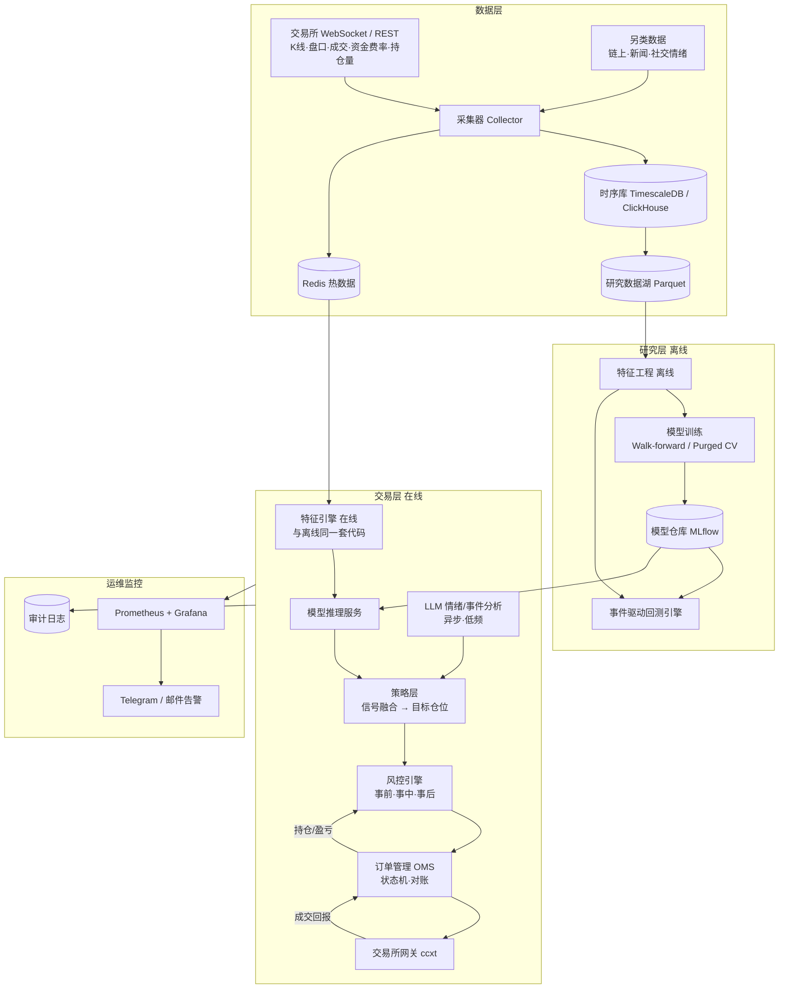

# AI 加密货币量化交易机器人 —— 架构设计与实施方案

> 版本：v0.1（设计稿）
> 适用范围：个人 / 小团队，中低频（分钟级 ~ 日级）CEX 交易，现货 + 永续合约

---

## 0. 先说清楚的几件事

1. **没有“稳赚”的机器人。** AI 只是提高决策质量的工具，绝大多数散户量化策略在扣除手续费、滑点、资金费率后是亏损的。系统设计的第一目标是**活下来（风控）**，第二目标才是赚钱。
2. **AI 不直接下单。** 模型只输出“信号/预测”，下单必须经过独立的、规则化的风控模块。大语言模型（LLM）不放在下单的实时链路里。
3. **回测 ≠ 实盘。** 必须走完 回测 → 模拟盘（Testnet / Paper）→ 小资金实盘 → 逐步加仓 的流程，每一步都有量化的准入标准。
4. **合规。** 请先确认你所在地区对加密货币交易、使用境外交易所、杠杆合约的法律规定。

---

## 1. 设计原则

| 原则 | 含义 |
|---|---|
| 风控优先 | 风控模块拥有一票否决权，任何信号都可以被拒绝；有全局熔断（Kill Switch） |
| 回测/实盘同构 | 策略代码在回测、模拟盘、实盘中**完全相同**，只替换数据源和执行网关 |
| 模块解耦 | 数据、特征、模型、风控、执行通过事件/接口通信，任一模块可独立替换 |
| 可复现 | 数据、特征、模型版本、参数全部可追溯，任何一笔交易都能复盘“为什么下单” |
| 故障安全 | 断网、交易所宕机、程序崩溃时默认行为是“停止开仓 + 保护已有仓位” |
| 先简单后复杂 | 先用规则策略跑通全链路，再上机器学习，最后才考虑深度学习 / 强化学习 |

---

## 2. 总体架构



**核心数据流：**

```
行情事件 → 特征更新 → 模型预测(概率/预期收益) → 策略生成目标仓位
        → 风控审核(可拒绝/缩减) → OMS 拆单下单 → 交易所 → 成交回报 → 更新持仓 → 风控再评估
```

---

## 3. 模块详细设计

### 3.1 数据层

**采集内容（按优先级）：**

| 优先级 | 数据 | 用途 | 来源 |
|---|---|---|---|
| P0 | OHLCV K线（1m 起，聚合到 5m/15m/1h/4h/1d） | 基础特征、回测 | 交易所 REST + WS |
| P0 | 资金费率、持仓量 OI、多空比 | 合约情绪特征、成本计算 | 交易所 API |
| P1 | 逐笔成交、盘口深度快照 | 微观结构特征、滑点估计 | 交易所 WS |
| P1 | 爆仓数据、基差（期现价差） | 情绪 / 套利 | 交易所 / Coinglass 等 |
| P2 | 链上数据（交易所净流入、稳定币供应） | 中长周期因子 | Glassnode / CryptoQuant / Dune |
| P2 | 新闻、X/Twitter、公告 | LLM 情绪与事件因子 | RSS / 新闻 API / 交易所公告 |

**关键设计点：**

- 统一使用 [ccxt](https://github.com/ccxt/ccxt)（REST）+ `ccxt.pro` 或交易所原生 WS（实时）。
- 所有时间统一为 **UTC 毫秒时间戳**；K 线以“收盘时间”标记，避免未来函数。
- 采集器要能**断点续传、自动补缺**：WS 断开后用 REST 补齐缺失区间，并做数据质量校验（缺失、重复、异常跳变）。
- 存储分层：
  - **Redis**：最新 N 根 K 线、最新盘口、当前持仓 —— 在线链路读这里。
  - **TimescaleDB / ClickHouse**：全量历史，支持 SQL 查询。
  - **Parquet（按 交易所/品种/周期/日期 分区）**：研究、训练用，配合 Polars / DuckDB 极快。

### 3.2 特征工程（Feature Engine）

**同一套特征代码同时服务离线训练和在线推理**，这是避免“回测好、实盘差”的关键。实现上把每个特征写成纯函数 `f(历史窗口) -> 值`，离线批量计算、在线增量计算。

特征分组示例：

| 类别 | 示例特征 |
|---|---|
| 价格/动量 | 多周期收益率、均线偏离、RSI、MACD、突破距离 |
| 波动率 | 实现波动率（多窗口）、ATR、Parkinson/Garman-Klass 波动率、波动率的变化率 |
| 成交量 | 成交量 Z-score、OBV、主动买卖比、VWAP 偏离 |
| 微观结构 | 盘口不平衡、价差、订单流不平衡（OFI） |
| 衍生品 | 资金费率及其变化、OI 变化率、基差、多空比、爆仓量 |
| 跨资产 | BTC 主导率、ETH/BTC、与 BTC 的滚动相关性/Beta、美股指数（如可得） |
| 时间 | 小时、星期（加密市场有明显的时段效应） |
| 情绪（LLM 产出） | 新闻情绪分数、事件类型标签（监管/黑客/上币/宏观） |

**处理规范：** 所有特征做滚动标准化（只用过去数据）；横截面策略再做排名标准化；严格检查每个特征的时间对齐。

### 3.3 AI 模型层

按“性价比”推荐的路线：

| 阶段 | 模型 | 说明 |
|---|---|---|
| 基线 | 规则策略（趋势跟踪 / 均值回归 / 资金费率套利） | 作为 AI 必须打败的基准，同时用来跑通全链路 |
| **主力** | **LightGBM / XGBoost（梯度提升树）** | 表格特征上效果好、训练快、不易过拟合、可解释（SHAP），**强烈推荐作为第一个 AI 模型** |
| 进阶 | 序列模型（TCN / LSTM / Transformer、TFT） | 数据量足够、有微观结构数据时再尝试 |
| 辅助 | LLM（大语言模型） | 新闻/公告/社交的情绪打分与事件分类，作为**一个特征**输入，不直接决策 |
| 谨慎 | 强化学习（PPO 等） | 极易过拟合模拟环境，不建议在前期使用 |

**预测目标（Label）设计：**

- 推荐 **三重障碍法（Triple-Barrier）**：以入场价为基准设置止盈线、止损线（按波动率缩放）和时间上限，看先触碰哪条 → 得到 {+1, 0, -1} 标签。比“下一根 K 线涨跌”更贴近真实交易。
- 或回归目标：未来 N 根 K 线的**波动率调整后收益**。
- 可叠加 **Meta-Labeling**：主模型决定方向，副模型预测“这次信号是否值得做”，用于过滤和仓位缩放。

**训练与验证（防过拟合是重中之重）：**

- **Walk-forward**：滚动训练窗口（如 12 个月）→ 预测下一段（如 1 个月）→ 向前滚动，只用样本外结果评估。
- **Purged K-Fold + Embargo**：交叉验证时剔除与测试集标签区间重叠的样本，并留隔离带，防止信息泄露。
- 多币种、多周期、多市场状态（牛/熊/震荡）分别检验稳健性。
- 用 **Deflated Sharpe Ratio** 修正“试了很多次才找到好结果”的多重检验偏差。
- 模型、特征版本、超参、训练数据区间全部登记到 **MLflow**。

**LLM 的定位：**

- 异步运行（例如每 5–15 分钟批量处理新闻），把结果写成结构化字段：`{symbol, sentiment: -1~1, event_type, confidence, ts}`，作为特征入库。
- 高频量的分类任务用小而快的模型（如 Claude Haiku 5.5），每日复盘报告、策略分析用更强的模型（如 Claude Sonnet 5.5）。
- 也可以用 LLM 做：每日交易复盘报告、异常行为解释、参数变更建议（**需人工确认**）。
- 严禁让 LLM 输出直接变成订单；LLM 输出要做格式校验，失败就忽略。

### 3.4 策略层（Signal → Target Position）

```python
class Strategy(ABC):
    """回测 / 模拟盘 / 实盘共用的策略接口"""

    @abstractmethod
    def on_bar(self, ctx: Context, bar: Bar) -> None: ...

    @abstractmethod
    def target_positions(self, ctx: Context) -> dict[str, float]:
        """返回各品种的目标仓位（占净值比例，正为多、负为空）"""
```

- 策略只输出**目标仓位**，不关心怎么下单 —— 下单是 OMS 的事。
- **信号融合**：多个模型/策略的输出加权（按近期样本外表现或风险平价分配权重）。
- **仓位计算**：
  - 波动率目标（Volatility Targeting）：`仓位 = 目标波动率 / 品种预测波动率 × 信号强度`
  - 分数凯利（1/4 ~ 1/2 Kelly）作为上限参考，绝不使用全凯利。
- **换仓阈值**：目标仓位与当前仓位差异小于阈值（如 10%）就不调整，降低手续费损耗。

### 3.5 风控引擎（最重要的模块）

风控是**独立进程/独立模块**，规则写死在配置里，不受模型影响。

**事前（下单前检查，任一不通过即拒绝或缩减）：**

| 规则 | 示例默认值 |
|---|---|
| 单品种最大仓位 | ≤ 净值 20% |
| 总敞口（多空绝对值之和） | ≤ 净值 1.5 倍 |
| 最大杠杆 | ≤ 3x（新手建议 1–2x） |
| 单笔最大下单金额 | ≤ 净值 5%，且 ≤ 盘口深度一定比例 |
| 价格偏离保护 | 限价单价格偏离最新价 > 1% 拒绝 |
| 下单频率限制 | 每分钟最多 N 笔，防止程序 bug 刷单 |
| 白名单 | 只允许交易配置中的品种 |

**事中（持仓监控）：**

- 每笔仓位都有止损（交易所侧条件单 + 本地监控双保险）。
- 强平价距离监控：距离强平 < X% 时自动减仓。
- 相关性监控：避免多个高度相关的币同方向重仓。

**事后 / 全局熔断（Kill Switch）：**

| 触发条件 | 动作 |
|---|---|
| 当日亏损 ≥ 净值 3% | 当日停止开新仓 |
| 从高点回撤 ≥ 15% | 全部平仓，系统进入只读模式，需人工恢复 |
| 行情数据中断 > 60s | 停止开仓 |
| 本地持仓与交易所持仓对账不一致 | 停止交易并告警 |
| 连续 N 次下单失败 / API 异常 | 停止交易并告警 |
| 实盘表现显著偏离回测（如滚动 Sharpe 跌出置信区间） | 降低仓位或暂停该策略 |

### 3.6 执行层（OMS + 交易所网关）

- **订单状态机**：`NEW → SUBMITTED → PARTIALLY_FILLED → FILLED / CANCELED / REJECTED`，所有状态变化落库。
- **幂等**：每笔订单生成唯一 `clientOrderId`，网络超时后先查询再决定是否重发，杜绝重复下单。
- **执行算法**：
  - 默认挂单（Post-only Maker）以节省手续费，超时未成交再追价或转市价。
  - 大单拆成 TWAP / 冰山单，控制冲击成本。
- **对账**：定时（如每 30 秒）拉取交易所实际持仓、挂单、余额，与本地状态比对。
- **限频**：遵守交易所 API 权重限制，做本地令牌桶。
- 网关抽象为接口，实现 `BacktestGateway`、`PaperGateway`、`BinanceGateway`、`OKXGateway`……，策略无感切换。

### 3.7 回测引擎

- **事件驱动**回测（逐 K 线 / 逐笔推送事件），与实盘共用策略和风控代码。
- 必须建模：**手续费（Maker/Taker 分开）、滑点（基于盘口深度或波动率）、资金费率、最小下单量/精度、延迟**。
- 研究阶段可用向量化回测（vectorbt / Polars）快速筛选想法，确认后再用事件驱动引擎精确验证。
- 输出指标：年化收益、年化波动、**Sharpe / Sortino / Calmar**、最大回撤及持续时间、胜率、盈亏比、换手率、手续费占比、每月收益分布。

可选的成熟框架（可直接用或借鉴）：

| 框架 | 特点 |
|---|---|
| [NautilusTrader](https://github.com/nautechsystems/nautilus_trader) | 专业级，回测/实盘同构，Rust 内核性能高，学习曲线较陡 |
| [Freqtrade](https://github.com/freqtrade/freqtrade) + FreqAI | 加密专用，上手最快，自带 ML 模块、Telegram、WebUI |
| [Hummingbot](https://github.com/hummingbot/hummingbot) | 偏做市 / 套利 |
| 自研（本文结构） | 最灵活，适合想深度定制 AI 部分 |

> **建议**：如果想尽快上线，先用 Freqtrade + FreqAI 验证想法；如果目标是长期可扩展的 AI 系统，采用本文的自研结构（或基于 NautilusTrader）。

### 3.8 监控与运维

- **指标**（Prometheus）：净值、持仓、当日盈亏、回撤、订单延迟、成交率、滑点、API 错误率、数据延迟、模型预测分布漂移。
- **看板**（Grafana）：实盘 vs 回测预期净值曲线对比。
- **告警**（Telegram Bot）：成交通知、风控触发、熔断、程序异常、每日报告；支持通过 Telegram 指令 `/status` `/pause` `/flatten`（需鉴权）。
- **日志**：结构化 JSON 日志；每笔交易记录“触发时的特征快照 + 模型输出 + 风控决策”，便于复盘。

### 3.9 安全

- API Key **只开交易权限，禁止提现权限**，并绑定服务器 IP 白名单。
- 使用交易所**子账户**隔离策略资金，主账户只做划转。
- 密钥放在环境变量 / Vault / 云 Secret Manager，**绝不提交到 Git**。
- 服务器：SSH 密钥登录、关闭密码登录、防火墙只开必要端口、定期更新。
- 依赖库锁定版本，警惕供应链攻击（尤其是加密相关的 npm/pypi 包）。

---

## 4. 技术栈

| 层 | 选型 | 备注 |
|---|---|---|
| 语言 | Python 3.12 | 生态最全；性能瓶颈处可用 Rust/Cython |
| 交易所接入 | ccxt / ccxt.pro，必要时用交易所官方 SDK | |
| 数据处理 | Polars、NumPy、DuckDB | Polars 比 Pandas 快很多 |
| 机器学习 | LightGBM、scikit-learn、PyTorch（进阶）、SHAP | |
| 实验管理 | MLflow、Optuna（超参搜索，注意过拟合） | |
| LLM | Claude API（Haiku 5.5 做批量分类，Sonnet 5.5 做分析报告） | 异步、非实时链路 |
| 存储 | TimescaleDB 或 ClickHouse、Redis、Parquet | |
| 消息/事件 | 单机：asyncio 内部事件总线；多进程：Redis Streams；规模更大：NATS / Kafka | |
| 配置 | Pydantic Settings + YAML | 配置强类型校验 |
| 监控 | Prometheus、Grafana、Telegram Bot | |
| 部署 | Docker Compose（单机起步） | 服务器选靠近交易所撮合引擎的区域（如币安/OKX 多在 AWS 东京） |
| 测试 | pytest、hypothesis | 风控和 OMS 必须有完整单元测试 |

---

## 5. 项目目录结构

```
ai_quant/
├── configs/
│   ├── base.yaml              # 全局配置
│   ├── risk.yaml              # 风控参数（独立文件，修改需审核）
│   └── strategies/            # 每个策略一份配置
├── src/ai_quant/
│   ├── core/                  # 事件、数据结构（Bar/Order/Position）、事件总线、时钟
│   ├── data/
│   │   ├── collectors/        # 交易所/另类数据采集器
│   │   ├── storage/           # DB/Parquet/Redis 读写
│   │   └── quality.py         # 数据质量校验
│   ├── features/              # 特征定义（离线/在线共用）
│   ├── models/
│   │   ├── labeling.py        # 三重障碍、Meta-label
│   │   ├── training.py        # Walk-forward、Purged CV
│   │   ├── inference.py       # 在线推理
│   │   └── llm_sentiment.py   # LLM 新闻/情绪分析
│   ├── strategies/            # 策略实现（基线 + ML 策略）
│   ├── portfolio/             # 信号融合、仓位计算
│   ├── risk/                  # 风控规则、熔断
│   ├── execution/
│   │   ├── oms.py             # 订单管理、状态机、对账
│   │   ├── algos.py           # TWAP / 挂单追价
│   │   └── gateways/          # backtest / paper / binance / okx
│   ├── backtest/              # 事件驱动回测引擎、绩效分析
│   ├── monitoring/            # 指标、告警、Telegram
│   └── app/                   # 启动入口：collector / trader / trainer
├── research/                  # Jupyter 研究笔记（不进生产）
├── tests/
├── docker/
│   └── docker-compose.yml
└── docs/
```

---

## 6. 推荐的第一个 AI 策略（MVP）

目标是**用最小复杂度跑通完整闭环**，而不是一上来就追求高收益。

| 项目 | 设定 |
|---|---|
| 市场 | 币安或 OKX 的 BTC/USDT、ETH/USDT 永续合约（流动性最好） |
| 周期 | 1 小时 K 线，每小时整点决策一次 |
| 特征 | 约 30–60 个：多周期动量、波动率、成交量、资金费率、OI 变化、时段 |
| 标签 | 三重障碍法：止盈/止损 = 1.5×ATR，时间上限 24 小时 |
| 模型 | LightGBM 三分类，输出上涨/下跌概率 |
| 信号 | `p_up - p_down` 超过阈值才开仓，强度映射到仓位 |
| 仓位 | 波动率目标 20% 年化，最大杠杆 2x |
| 执行 | Post-only 挂单，60 秒未成交改为追价 |
| 风控 | 第 3.5 节默认值 |
| 基准 | 同期 Buy & Hold、双均线趋势策略 —— AI 策略扣费后必须稳定跑赢 |

---

## 7. 实施路线图

| 阶段 | 时间（参考） | 交付内容 | 进入下一阶段的标准 |
|---|---|---|---|
| **P0 数据** | 第 1–2 周 | 采集器、存储、数据质量检查；拉取 3–5 年历史 K 线、资金费率 | 数据连续无缺口，可稳定 7×24 采集 |
| **P1 回测 + 基线** | 第 3–5 周 | 核心数据结构、事件驱动回测引擎、手续费/滑点/资金费率模型、2 个规则基线策略、风控模块 + 单元测试 | 回测结果可复现；风控测试全部通过 |
| **P2 AI 模型** | 第 6–8 周 | 特征库、三重障碍标签、LightGBM、Walk-forward 训练、SHAP 分析、MLflow | 样本外扣费 Sharpe > 1（参考），在不同年份/市场状态下都不崩 |
| **P3 模拟盘** | 第 9–12 周 | OMS、交易所网关、Testnet/Paper 交易、监控告警、Telegram | 连续运行 ≥ 4 周无严重故障；模拟盘表现与回测在合理误差内 |
| **P4 小资金实盘** | 第 3–4 个月 | 用**亏光也能接受**的小资金实盘 | 实盘滑点、成交率符合预期；风控实际触发验证有效 |
| **P5 扩展** | 之后 | LLM 情绪因子、更多币种（横截面策略）、多策略组合、模型自动重训与漂移监控 | 每次新增都先走 P2–P4 流程 |

---

## 8. 常见陷阱清单

- **未来函数（Look-ahead Bias）**：用了当根未收盘 K 线、用全样本做标准化、资金费率时间对错。
- **幸存者偏差**：只用现在还存在的币回测，忽略了已下架/归零的币。
- **过拟合**：调参次数太多、特征太多样本太少、只在牛市数据上验证。
- **低估成本**：高换手策略在扣除 Taker 手续费 + 滑点 + 资金费率后往往由盈转亏。
- **流动性幻觉**：小币回测收益很高，实盘根本成交不了那么大的量。
- **市场状态切换**：2021 年牛市有效的策略，2022 年熊市可能大幅回撤 —— 要做分市场状态检验，并设置策略级别熔断。
- **工程故障**：重复下单、止损单未挂上、时区错误、交易所维护。这些造成的亏损往往比策略本身更大。

---

## 9. 待确认的问题（会影响具体方案）

1. 计划投入的资金规模？（影响可交易的品种、执行算法复杂度）
2. 交易所选择？（币安 / OKX / Bybit / 其他）
3. 只做现货，还是也做永续合约（杠杆、做空）？
4. 交易频率偏好？（日内高频 / 小时级 / 日级）
5. 你的编程和机器学习基础？（决定是用 Freqtrade 快速起步还是自研）
6. 运行环境：云服务器还是本地电脑？
